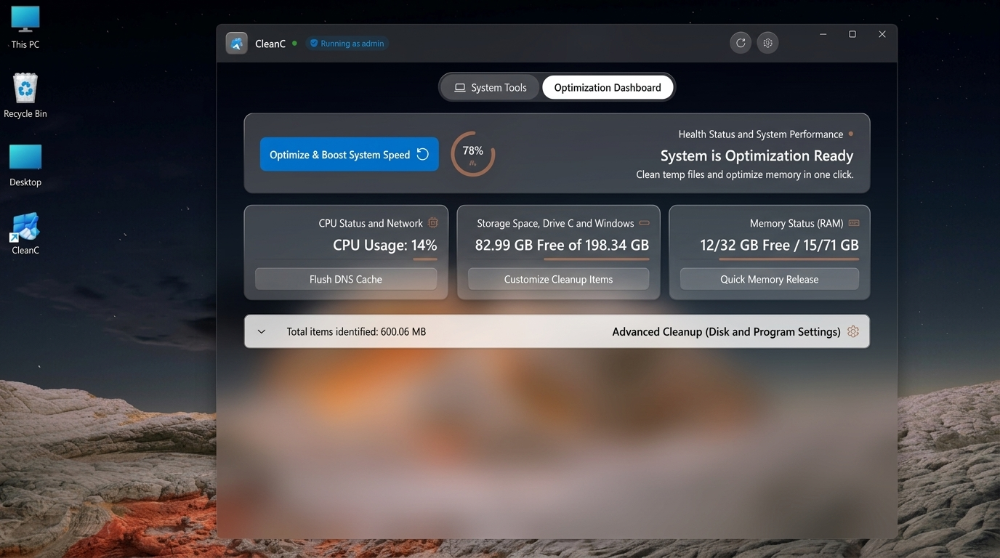
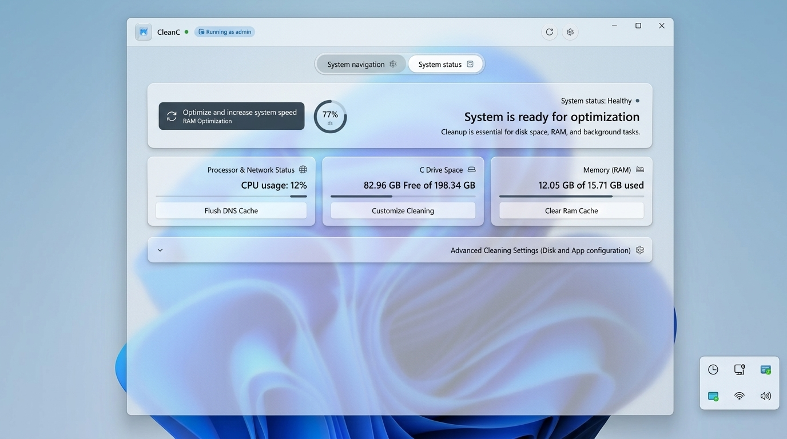

  

<h1 align="center">WinyWash</h1>

  <b>Next-Generation Native Windows 11 Fluent PC Optimizer & Cleaner</b> 
  Built with WinUI 3, Desktop Acrylic Material, and .NET 10 (win-x64 Native).

  
  
  
  
  
  

---

## ⚡ Quick Start

WinyWash is **completely portable** and ready to run. No installation or setup wizard is required!

1. Download or clone this repository, or grab the latest **`WinyWash-Release-win-x64.zip`** from [Releases](https://github.com/mohammad-ahw/WinyWash/releases).
2. Double-click **`WinyWash.exe`** to launch.
3. Enjoy an ultra-fast, smooth, and elegant Windows cleanup experience!

> [!NOTE]
> All core application libraries and resources are neatly organized in the `app/` subfolder. Simply run `WinyWash.exe` from the root of this folder.

---

## 🌟 Key Features

* **🎨 Pure Fluent Design & Desktop Acrylic:** Native Windows 11 UI with deep mica/acrylic materials, seamless dark/light theme switching, and smooth animations.
* **🧹 Deep System Cleaner:** Safely cleans temp files, caches, crash dumps, delivery optimization files, Windows update leftovers, and dev tool caches (npm, pip, docker, nuget, etc.) with strict safety quarantine.
* **⚡ RAM & Memory Optimization:** Real-time RAM monitoring and one-click working set reduction.
* **🛡️ Windows Privacy & Telemetry Tweaks:** Fine-tune Windows settings, disable unnecessary diagnostic tracking, and optimize startup apps safely.
* **📰 Live News Hub:** Integrated curated top daily stories:
  * **English / International:** *The Verge, TechCrunch AI, Wired, Ars Technica, Yahoo Sports*
  * **Persian (fa-IR):** *Akharin Khabar, Digiato, Zoomit*
  * Full distraction-free reader mode with clean typography and custom themes.
* **🤖 Winy Companion Hero:** An interactive animated desk companion who reacts to system health, CPU/RAM spikes, battery status, and jokes with you.
* **🌍 10 Languages Supported:** Persian (فارسی), English, Arabic (العربية), German, Spanish, French, Japanese, Korean, Russian, and Simplified Chinese with full bidirectional RTL/LTR support.

---

## 📸 Screenshots

  

  

---

## 💻 System Requirements

* **Operating System:** Windows 11 (all versions) or Windows 10 (version 19041 / 20H1 or newer).
* **Architecture:** 64-bit (x64).
* **Runtime:** Self-contained (no external .NET installation required).

---

---

## 🔒 Privacy & Network Transparency

WinyWash values your privacy above all else. **The application contains zero telemetry, zero analytics tracking, and zero personal data collection.**

For complete transparency, here is the full list of external network endpoints used exclusively for optional, user-facing features:

| Endpoint / Domain | Purpose | Data Transmitted |
| :--- | :--- | :--- |
| `open-meteo.com` | Fetches local temperature and weather condition codes for the desk companion | Latitude & longitude coordinates only (no personal data) |
| `ipwho.is` / `ipapi.co` / `api.ipify.org` | Automatic city and country detection for companion weather (only queried if no custom city is configured) | IP address strictly for geographic location lookup |
| `api.github.com` | Checks for official releases and updates on demand | None (standard anonymous HTTP GET) |
| News RSS Feeds (`theverge.com`, `techcrunch.com`, `wired.com`, `arstechnica.com`, `yahoo.com`, `akharinkhabar.ir`, `digiato.com`, `zoomit.ir`) | Retrieves public headlines and reader mode articles | None (standard anonymous HTTP GET) |
| `speed.cloudflare.com` / `cachefly` | Measures network download latency and bandwidth (only when you explicitly click "Run Speed Test") | Anonymous byte download for throughput calculation |

> [!IMPORTANT]
> All core cleaning, system scanning, RAM optimization, startup management, and registry checks run **100% locally and offline** on your machine.

## 📄 License

This project is licensed under the [MIT License](LICENSE).
