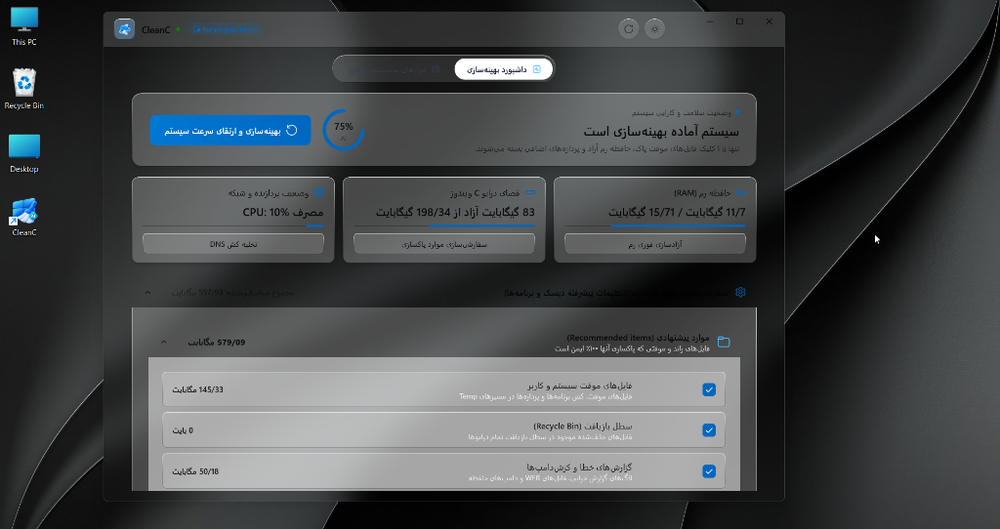

<div align="center">

  

  # CleanC

  ### Next-Generation Native Windows 11 PC Optimizer & Deep Cleaner
  **بهینه‌ساز و پاک‌کننده هوشمند نسل جدید ویندوز ۱۱ با طراحی مات شیشه‌ای (Desktop Acrylic)**

  <p align="center">
    <a href="https://github.com/mohammad-ahw/CleanC/releases/latest">
      
    </a>
    
    
    
    <a href="LICENSE">
      
    </a>
  </p>

  <p align="center">
    <strong><a href="#-english">English</a></strong> • <strong><a href="#-فارسی-persian">فارسی (Persian)</a></strong> • <strong><a href="#-download--installation">Download</a></strong> • <strong><a href="#-features">Features</a></strong> • <strong><a href="#-cli-mode--automation">CLI Automation</a></strong>
  </p>

</div>

---

## 🇬🇧 English

### Overview

**CleanC** is a modern, ultra-fast, and privacy-respecting system cleaner and performance optimizer tailored for **Windows 11 and Windows 10**. Built natively with **.NET 8** and **WinUI 3 (Windows App SDK)**, CleanC ditches legacy bloatware practices—no background daemon services, no aggressive telemetry, and no ads.

Featuring a signature **Desktop Acrylic glassmorphism interface**, CleanC blends seamlessly into your Windows desktop while delivering low-level memory defragmentation, safe multi-layer junk scanning, and network DNS optimization.

---

### ✨ Key Features

- 🪟 **True Desktop Acrylic Glassmorphism**: Stunning translucent frosted glass UI that blends into your desktop wallpaper with native Windows 11 compositor effects (`DesktopAcrylicController`).
- 🎨 **Adaptive Wallpaper Luminance & Windows Accent Color**:
  - Dynamically samples the active desktop wallpaper brightness to adjust text contrast for **100% legibility** across any background (dark landscapes, vibrant themes, or bright snow/glaciers).
  - The primary boost button dynamically inherits your **Windows 11 Accent Color**, creating a cohesive OS-level visual harmony.
- ⚡ **1-Click Deep System Boost**:
  - Clears working set memory for inactive processes (`EmptyWorkingSet` Win32 API) without terminating tasks.
  - Flushes Windows DNS client cache (`DnsFlushResolverCache`).
  - Purges recommended temporary clutter in under 500 milliseconds.
- 🧹 **Granular & Safe Disk Cleaner**:
  - Deep scans User & System Temp folders (`%TEMP%`, `C:\Windows\Temp`).
  - Cleans Windows Error Reporting crash dumps (`WER`), memory logs, and update caches.
  - Recycle Bin manager with itemized previews and real-time freed storage stats.
- 💻 **Dual Mode: WinUI 3 Modern GUI + Lightning CLI**:
  - Full-featured graphical dashboard for everyday desktop use.
  - High-performance Terminal CLI (`--cli`) for power users, plus silent background mode (`--silent`) ideal for scheduled tasks and enterprise scripts.
- 🛠️ **Built-in Windows Diagnostic Quick-Launcher**:
  - Instant 1-click access to Task Manager, Registry Editor, Services, Resource Monitor, Device Manager, and Windows Terminal.
- 📦 **100% Portable & Lightweight**:
  - Self-contained x64 deployment. Zero installation required, zero footprint in registry, and runs right out of the folder.

---

### 📸 Visual Showcase

<div align="center">

#### Dark Mode with Translucent Desktop Acrylic


#### Light Mode with Wallpaper-Adaptive Contrast


#### Itemized Safe Scan & Advanced Clean Preferences


</div>

---

### 🚀 Download & Installation

#### Option 1: Standalone Portable (Recommended)

1. Head to the **[Releases](https://github.com/mohammad-ahw/CleanC/releases/latest)** page.
2. Download the latest `CleanC-v1.0.0-win-x64.zip`.
3. Extract the archive anywhere on your machine (e.g., `C:\Tools\CleanC` or your Desktop).
4. Run `CleanC.UI.exe` (or run `CreateShortcut.bat` to place an icon on your desktop).

> [!NOTE]
> CleanC requests administrator privileges (`requireAdministrator`) in order to clean system-level temp directories (`C:\Windows\Temp`) and perform memory working set compaction across all processes.

#### Option 2: Build from Source

```powershell
# Clone the repository
git clone https://github.com/mohammad-ahw/CleanC.git
cd CleanC

# Publish self-contained Release
dotnet publish src\CleanC.UI\CleanC.UI.csproj -c Release -r win-x64 --self-contained true -o publish
dotnet publish src\CleanC.Cli\CleanC.Cli.csproj -c Release -r win-x64 --self-contained true -o publish

# Run the app
.\publish\CleanC.Cli.exe
```

---

### ⌨️ CLI Mode & Automation

CleanC includes an integrated Command Line Interface (CLI) for system administrators and automation scripts:

```powershell
# Launch the WinUI 3 graphical user interface (default)
.\CleanC.Cli.exe

# Interactive Terminal CLI dashboard
.\CleanC.Cli.exe --cli

# Silent mode: Performs instant 1-click optimization silently in background
.\CleanC.Cli.exe --silent
```

#### Automate with Windows Task Scheduler:
To automatically optimize your system every day at logon:
```powershell
Register-ScheduledTask -TaskName "CleanC_DailyBoost" `
  -Action (New-ScheduledTaskAction -Execute "C:\Tools\CleanC\CleanC.Cli.exe" -Argument "--silent") `
  -Trigger (New-ScheduledTaskTrigger -AtLogOn) `
  -Principal (New-ScheduledTaskPrincipal -UserId "SYSTEM" -LogonType ServiceAccount -RunLevel Highest)
```

---

### 📊 CleanC vs Traditional Cleaners

| Feature | CleanC | Legacy Cleaners (CCleaner, etc.) |
| :--- | :---: | :---: |
| **Open Source** | ✅ **Yes (MIT)** | ❌ Closed Source |
| **UI Design** | 💎 **WinUI 3 Fluent + Acrylic Glass** | 🪟 Outdated Win32 / Electron |
| **Wallpaper Contrast Adaptation** | ✅ **Automatic** | ❌ No |
| **System Accent Color Sync** | ✅ **Automatic** | ❌ No |
| **Background Daemons / Services** | ❌ **Zero (Clean)** | ⚠️ Yes (Persistent telemetry) |
| **Bundled Ads or Offers** | ❌ **None** | ⚠️ Yes (Upsells, adware) |
| **Native Working Set Compaction** | ✅ **Safe Win32 API** | ⚠️ Aggressive kill |
| **CLI & Silent Scripting** | ✅ **Included** | ⚠️ Paid edition only |

---

<br/>

## 🇮🇷 فارسی (Persian)

### معرفی نرم‌افزار

**کلین‌سی (CleanC)** یک ابزار بهینه‌ساز، پاک‌کننده فایل‌های زائد و تقویت‌کننده عملکرد سیستم برای **ویندوز ۱۱ و ۱۰** است که با معماری مدرن **.NET 8** و **WinUI 3 (Windows App SDK)** توسعه یافته است. بر خلاف نرم‌افزارهای تجاری رایج که سرشار از تبلیغات آزاردهنده، سرویس‌های مخفی در پس‌زمینه و ردیاب‌ها هستند، CleanC کاملاً **سبک، امن، متن‌باز و بدون هیچ‌گونه سربار اضافی** است.

این نرم‌افزار با بهره‌گیری از فناوری بومی **Desktop Acrylic** پنجره‌ای شیشه‌ای و چشم‌نواز ایجاد می‌کند که پس‌زمینه دسکتاپ شما را به زیباترین شکل با بلور ملایم به نمایش می‌گذارد.

---

### 🌟 قابلیت‌های برجسته

- 🪟 **طراحی مدرن شیشه‌ای مات (Desktop Acrylic)**: بهره‌گیری از ترنسپرنسی عمیق و بلور شیشه‌ای طبیعی ویندوز ۱۱ (`DesktopAcrylicController`) منطبق بر زبان طراحی Fluent Design.
- 🎨 **هوش تطبیقی با والپیپر و رنگ اختصاصی ویندوز (Accent Color)**:
  - سنجش خودکار میزان روشنایی (Luminance) تصویر زمینه برای تنظیم هوشمند کنتراست متون (سفید یا مشکی) به منظور **خوانایی ۱۰۰٪** در انواع والپیپرها (از تصاویر برفی و بیابانی روشن تا والپیپرهای تاریک شب).
  - هماهنگی خودکار دکمه بهینه‌سازی اصلی با **Accent Color انتخابی ویندوز شما** (رنگ استخراج شده از تصویر زمینه).
- ⚡ **بهینه‌سازی سریع ۱-کلیکی (Quick Boost)**:
  - آزادسازی آنی رم با تکنیک استاندارد `EmptyWorkingSet` از حافظه پروسه‌های غیرفعال بدون بستن برنامه‌های شما.
  - تخلیه و نوسازی آنی کش آدرس‌های شبکه (`Flush DNS`).
  - پاکسازی سریع فایل‌های موقت بدون معطلی و در کسری از ثانیه.
- 🧹 **پاک‌کننده عمیق و هوشمند دیسک**:
  - اسکن عمیق و ایمن پوشه‌های موقت سیستم و کاربر (`%TEMP%` و `C:\Windows\Temp`).
  - پاکسازی فایل‌های گزارش خرابی ویندوز (`WER Crash Dumps`) و لاگ‌های زائد سیستمی.
  - مدیریت و تخلیه سطل بازیافت با امکان بازبینی جزئیات و پیش‌نمایش حجم آزاد شده.
- 💻 **پشتیبانی دوگانه از رابط گرافیکی (GUI) و خط فرمان (CLI)**:
  - محیط گرافیکی کامل برای استفاده روزمره.
  - حالت ترمینال سریع (`--cli`) برای کاربران حرفه‌ای و سوییچ اجرای سایلنت (`--silent`) برای استفاده در اسکریپت‌ها یا زمان‌بندی ویندوز.
- 🛠️ **دسترسی سریع به ابزارهای مدیریتی سیستم‌عامل**:
  - لانچر مستقیم و ۱-کلیکی Task Manager، ویرایشگر رجیستری، Device Manager، مدیریت سرویس‌ها، Resource Monitor و ترمینال ویندوز.
- 📦 **کاملاً پرتابل و بدون ردپا**:
  - بدون نیاز به نصب (Portable)، بدون تغییرات مخرب در رجیستری و قابل اجرا از روی فلش یا هر پوشه دلخواه.

---

### 📥 راهنمای دریافت و اجرا

#### روش ۱: نسخه آماده پرتابل (پیشنهادی)

1. به بخش **[Releases](https://github.com/mohammad-ahw/CleanC/releases/latest)** مراجعه کنید.
2. آخرین نسخه `CleanC-v1.0.0-win-x64.zip` را دانلود کنید.
3. فایل فشرده را در محل مورد نظر خود (مانند `C:\Tools\CleanC` یا دسکتاپ) استخراج کنید.
4. فایل `CleanC.UI.exe` را اجرا کنید (یا با اجرای `CreateShortcut.bat` آیکون میانبر آن را به دسکتاپ خود اضافه کنید).

> [!NOTE]
> نرم‌افزار برای پاکسازی دایرکتوری‌های سیستمی ویندوز و بهینه‌سازی حافظه رم پروسه‌های سیستمی، نیازمند دسترسی ادمین (`Run as Administrator`) می‌باشد که به صورت خودکار از کاربر درخواست می‌شود.

#### روش ۲: کامپایل از سورس‌کد

```powershell
# کلون کردن مخزن
git clone https://github.com/mohammad-ahw/CleanC.git
cd CleanC

# بیلد نسخه نهایی
dotnet publish src\CleanC.UI\CleanC.UI.csproj -c Release -r win-x64 --self-contained true -o publish
dotnet publish src\CleanC.Cli\CleanC.Cli.csproj -c Release -r win-x64 --self-contained true -o publish

# اجرا
.\publish\CleanC.Cli.exe
```

---

### 💻 محیط خط فرمان (CLI) و اتوماسیون

کلین‌سی علاوه بر محیط گرافیکی زیبا، دارای کنترل کامل از طریق ترمینال است:

```powershell
# اجرای عادی نرم‌افزار با رابط کاربری گرافیکی
.\CleanC.Cli.exe

# ورود به منوی تعاملی خط فرمان (CLI Mode)
.\CleanC.Cli.exe --cli

# بهینه‌سازی آنی در پس‌زمینه بدون نمایش پنجره (Silent Mode)
.\CleanC.Cli.exe --silent
```

#### زمان‌بندی بهینه‌سازی روزانه در ویندوز:
برای تنظیم بهینه‌سازی خودکار در هنگام ورود به سیستم:
```powershell
Register-ScheduledTask -TaskName "CleanC_DailyBoost" `
  -Action (New-ScheduledTaskAction -Execute "C:\Tools\CleanC\CleanC.Cli.exe" -Argument "--silent") `
  -Trigger (New-ScheduledTaskTrigger -AtLogOn) `
  -Principal (New-ScheduledTaskPrincipal -UserId "SYSTEM" -LogonType ServiceAccount -RunLevel Highest)
```

---

### ⚖️ لایسنس و حقوق نرم‌افزار

این پروژه تحت لایسنس **[MIT](LICENSE)** منتشر شده است. استفاده، تغییر و توسعه‌ی این نرم‌افزار برای اهداف شخصی و تجاری کاملاً آزاد و رایگان می‌باشد.

<div align="center">

Made with ❤️ for the Windows Community by **[Mohammad (mohammad-ahw)](https://github.com/mohammad-ahw)**

</div>
